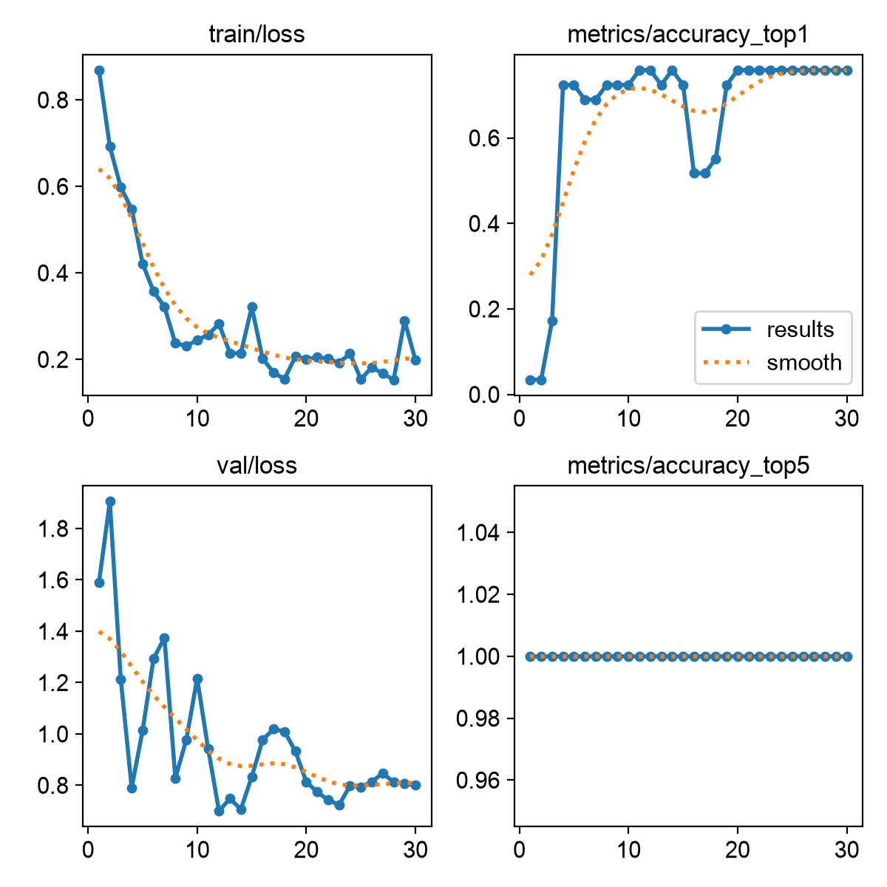
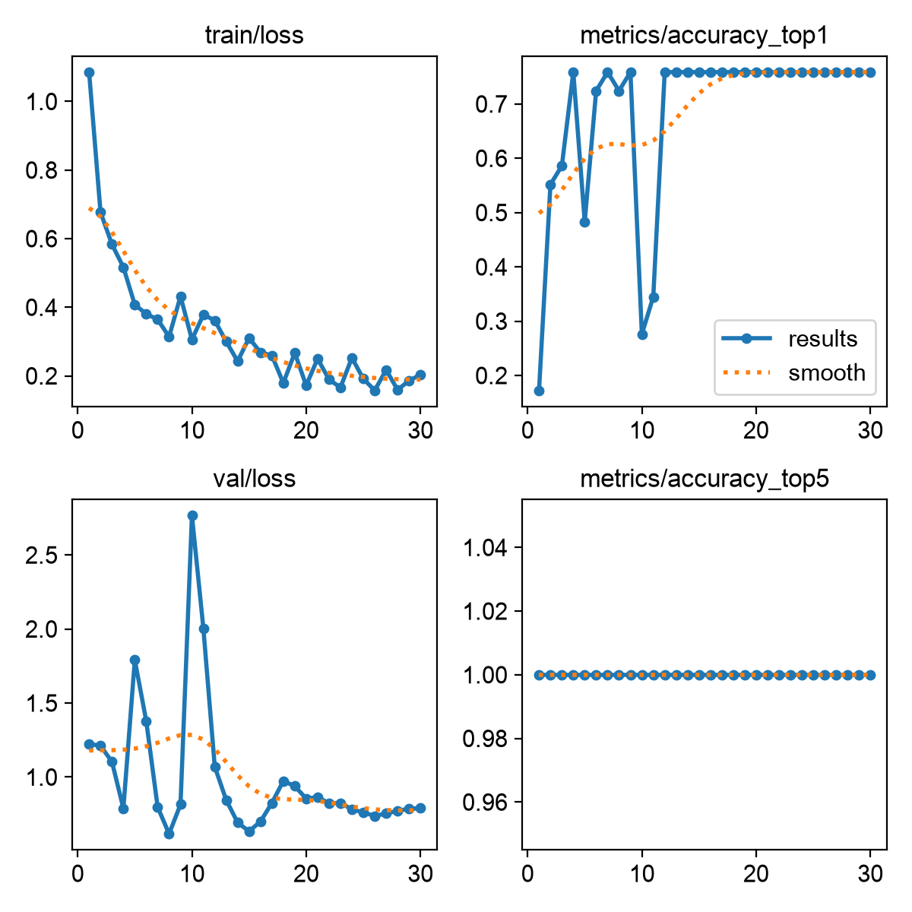
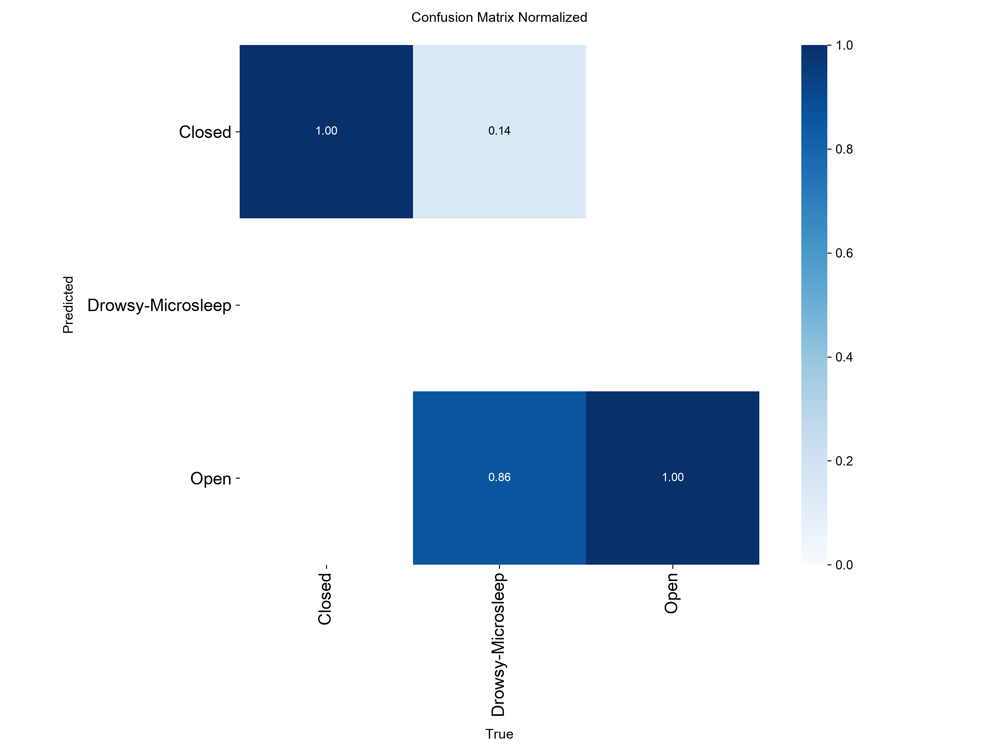

# 😴 DrowseGuard

**A browser-based driver-monitoring research prototype** for exploring eye closure, blinks, and frontal-face alignment.

> [!WARNING]
> Research use only—not a certified safety system or medical device. Never use DrowseGuard while driving or to make driving decisions. Its measurements and alerts are experimental.

## ✨ What you can test

- **MediaPipe:** eye aspect ratio (EAR), blink transitions, long closures, mouth opening, and face alignment.
- **YOLOv8 / YOLO11 ONNX classifiers:** display a full-frame class prediction alongside MediaPipe landmark monitoring.
- **Live telemetry:** inference time, pipeline FPS, face-tracking coverage, and session CSV logs.
- **Private by design:** camera frames and locally selected ONNX files are processed in the browser, not uploaded by the app.

## 🚀 Start the app

From the project root, run:

```powershell
python -m http.server 8000
```

Open [http://localhost:8000](http://localhost:8000), allow camera access, choose a mode, then select **Start Detection**. Use `Ctrl+C` in the server terminal to stop it. A local server is recommended instead of opening `index.html` directly.

MediaPipe assets and ONNX Runtime Web are loaded from CDNs, so an internet connection is required. No package install or build step is needed.

## 🧠 Choose a model

| Mode | What it does | Alert source |
| --- | --- | --- |
| MediaPipe | Tracks face landmarks and eye/mouth metrics | EAR, face alignment, and mouth measurements |
| YOLO frame classification + MediaPipe | Displays a YOLO class prediction while MediaPipe measures eyes and face alignment | MediaPipe only; the YOLO class does not trigger alerts |

### Load the YOLOv8 and YOLO11 classifiers

The app supports one YOLO classifier at a time. The included eye-state ONNX weights are:

```text
trained_models\yolov8n-eye-state\weights\best.onnx
trained_models\yolo11n-eye-state\weights\best.onnx
```

To load either model, select **YOLOv8 classifier + MediaPipe** or **YOLO11 classifier + MediaPipe** in the inference-mode selector, browse to the matching `best.onnx` file, enter its labels in the model's output order, then select **Start Detection**. For the included eye-state classifiers, use `Closed,Drowsy-Microsleep,Open`. Switch models by stopping detection, selecting the other runtime, loading its ONNX file, and starting again.

### 🏷️ Configure a classifier

The browser accepts `.onnx` files, not `.pt` files. Selected files remain available while the page is open; after a page reload, select the model file again. The classifier input is a center-cropped, RGB, batch-1 224×224 frame normalized to the 0–1 range. Configure the exact class labels in output order, separated by commas.

The included eye-state models are small, experimental full-frame classifiers—not eye detectors. Their class predictions are displayed for reference but do not trigger alerts. MediaPipe EAR drives eye-closure and blink measurements in both MediaPipe mode and YOLO classifier + MediaPipe mode. Eye-closure alerts begin after the selected sensitivity duration (0.7, 1.0, or 1.5 seconds), repeat every 5 seconds while the eyes remain closed, and clear automatically when the eyes reopen. The app estimates frontal-face alignment from landmark symmetry; below 70% for about 1.2 seconds triggers a gaze alert. It repeats every 5 seconds while alignment remains below the threshold and clears automatically after alignment recovers to 70% or higher. This score is not a literal percentage of visible face pixels.

If you load a compatible gaze-zone classifier, its class labels must also match its output order. The DMD gaze-zone classifiers use:

```text
center_mirror,front,front_right,infotainment,left,left_mirror,right,right_mirror,steering_wheel
```

They display an experimental YOLO prediction but do not trigger gaze alerts. Gaze alerts come from MediaPipe face alignment.

## 🎤 Presentation brief

### Project summary

DrowseGuard is a browser-based driver-monitoring research prototype. It processes a live camera stream locally and demonstrates face/eye monitoring with MediaPipe and optional YOLO ONNX models. It is an educational prototype, not a validated driver-safety system.

### Processing flow

1. The browser requests camera permission and displays a horizontally mirrored preview.
2. The selected runtime processes up to 15 frames per second for MediaPipe or 10 frames per second for YOLO inference.
3. MediaPipe derives face landmarks and, when enabled, eye aspect ratio (EAR), mouth measurements, and a face-alignment estimate.
4. In hybrid mode, YOLO ONNX classifies the full frame while MediaPipe—not the YOLO class prediction—drives eye-closure, blink, and face-alignment metrics and alerts.
5. The dashboard updates metrics and records session samples and alert events in memory; logs can be exported as CSV.

### Model comparison

| Runtime | Mode in this project | What it reports | Alert behavior |
| --- | --- | --- | --- |
| MediaPipe Face Landmarker | Landmark monitoring | Face landmarks, EAR/blinks, mouth measurements, face alignment | MediaPipe thresholds |
| YOLOv8 ONNX + MediaPipe | Full-frame classifier + landmarks | Class score, inference time, pipeline FPS, MediaPipe metrics | MediaPipe thresholds |
| YOLO11 ONNX + MediaPipe | Full-frame classifier + landmarks | Class score, inference time, pipeline FPS, MediaPipe metrics | MediaPipe thresholds |

The YOLO class score is experimental and is not used to trigger alerts. These modes are not a like-for-like accuracy comparison because all alerting relies on MediaPipe landmark measurements.

### Suggested slide outline

1. **Problem and motivation:** demonstrate how prolonged eye closure or loss of face alignment can be monitored; do not present this prototype as a real driving aid.
2. **Project objective:** show local, browser-based experimentation with camera input, MediaPipe landmarks, and optional YOLO ONNX inference.
3. **System architecture:** camera → frame processing → selected model/runtime → dashboard metrics and configured alerts.
4. **Models and features:** explain MediaPipe, YOLOv8 + MediaPipe, and YOLO11 + MediaPipe. Emphasize that the YOLO classifiers report class scores while MediaPipe drives alerts.
5. **Demo and measurements:** show a controlled test, live inference/FPS telemetry, alert behavior, and exported CSV.
6. **Results, limitations, and next steps:** report only measured results; discuss dataset size, class balance, device dependence, and the need for independent validation.

## Results and Analysis

### Recorded validation results

The repository contains validation outputs for four Ultralytics classifier runs. These numbers measure full-frame classification accuracy, not the accuracy of the browser dashboard's eye-closure or frontal-gaze alerts.

| Experiment | Model | Epochs | Final top-1 accuracy | Final top-5 accuracy | Final validation loss |
| --- | --- | ---: | ---: | ---: | ---: |
| Eye state | YOLOv8n-cls | 30 | 75.86% | 100.00% | 0.79976 |
| Eye state | YOLO11n-cls | 30 | 75.86% | 100.00% | 0.78951 |
| DMD gaze zones | YOLOv8n-cls | 18 | 98.39% | 100.00% | 0.08276 |
| DMD gaze zones | YOLO11n-cls | 18 | 90.32% | 100.00% | 0.16910 |

Both eye-state models completed 30 epochs and produced identical final top-1 accuracy. The DMD gaze-zone result reports YOLOv8n-cls as the stronger classifier in this run, with 98.39% final top-1 accuracy compared with 90.32% for YOLO11n-cls. The gaze-zone runs stopped after 18 epochs, so these values are not necessarily the fully converged performance of the two architectures.

### Accuracy comparison

| Task | Better recorded classifier | Reported result | Interpretation |
| --- | --- | ---: | --- |
| Eye state | Tie: YOLOv8n-cls / YOLO11n-cls | 75.86% top-1 | Too limited for a defensible real-world generalization claim |
| Gaze zones | YOLOv8n-cls | 98.39% top-1 | Best recorded run, but currently from a temporal/single-recording DMD setup |

For the eye-state experiment, the held-out split contains only 29 validation frames and just one `Closed` example. For that reason, 75.86% top-1 accuracy is not reliable evidence of real-world performance or class-level correctness.

The gaze-zone run was generated by `train_dmd_gaze_classifiers.py` and should also be interpreted cautiously. The available DMD setup does not establish independent-driver, independent-session, or cross-device generalization.

### Performance graphs

Training curves and confusion matrices are available for the two eye-state runs:

| YOLOv8n eye state | YOLO11n eye state |
| --- | --- |
|  |  |
|  |  |

Gaze-zone training curves and confusion matrices are stored under:

- [YOLOv8n gaze-zone results](trained_models/yolov8n-gaze-zones/results.png)
- [YOLO11n gaze-zone results](trained_models/yolo11n-gaze-zones/results.png)
- [YOLOv8n normalized confusion matrix](trained_models/yolov8n-gaze-zones/confusion_matrix_normalized.png)
- [YOLO11n normalized confusion matrix](trained_models/yolo11n-gaze-zones/confusion_matrix_normalized.png)

### Live FPS and inference-time comparison

The live browser benchmark recorded the following results:

| Runtime | Measured inference time | Measured pipeline FPS | Status |
| --- | ---: | ---: | --- |
| MediaPipe Face Landmarker | 16.4 ms | 23 FPS | Measured |
| YOLOv8n ONNX + MediaPipe | 12.1 ms | 28 FPS | Measured |
| YOLO11n ONNX + MediaPipe | 13.8 ms | 26 FPS | Measured |

In this benchmark, YOLOv8n was the fastest runtime at 12.1 ms and achieved the highest pipeline throughput at 28 FPS. YOLO11n was the second-fastest runtime at 13.8 ms and 26 FPS. MediaPipe recorded 16.4 ms and 23 FPS. The YOLOv8n result was 4.3 ms faster than MediaPipe, and its pipeline FPS was 5 FPS higher.

The test environment was not specified, so these values should be presented as results for the recorded run rather than guaranteed cross-device performance. The app currently caps MediaPipe at 15 inference FPS and YOLO hybrid modes at 10 inference FPS. FPS is therefore controlled partly by application limits and browser hardware, not only by model speed. The benchmark is more useful for this device and browser configuration than for a general claim across different systems.

Smaller YOLO inference times do not prove that YOLO drives faster alerts, because both hybrid modes still use MediaPipe for eye-closure and face-alignment decisions. The measured timing difference shows faster YOLO classifier processing, while end-to-end alert reaction time requires a separate synchronized event-onset test.

### Alert reaction-time benchmark

No controlled, end-to-end alert reaction-time results have been recorded for the three modes. Do not substitute a configured alert threshold or model inference duration for reaction time. YOLO class scores do not trigger alerts; in both hybrid modes the alert reaction time reflects MediaPipe landmark monitoring.

To create a defensible result table:

1. Use the same recording, camera or device, browser, resolution, lighting, and sensitivity for all modes.
2. Synchronize a known ground-truth event onset with the recording and label at least 10 trials.
3. Warm up each model before measurement and export each session CSV.
4. Record each model's median inference time and pipeline FPS.
5. Calculate end-to-end alert reaction time as `alert timestamp - event-onset timestamp`.
6. Report median, minimum, maximum, standard deviation or range, browser/device, model file, and trial count.

Keep inference time and end-to-end reaction time separate. The app's telemetry does not provide ground-truth event onset.

### Which model performs best?

- **Best recorded eye-state classifier:** YOLOv8n-cls and YOLO11n-cls tie at 75.86% final top-1 accuracy. Neither result is strong enough to rank real-world performance because the validation set is tiny and imbalanced.
- **Best recorded gaze-zone classifier:** YOLOv8n-cls at 98.39% top-1 on its available 18-epoch run. YOLO11n-cls reached 90.32%, but the setup is not independent enough for a generalization claim.
- **Best alerting component:** MediaPipe is the implementation that supplies the measured EAR/blink, mouth, and face-alignment alert decisions. YOLO predictions are experimental reference classifications and do not trigger alerts.
- **Fastest measured runtime:** YOLOv8n ONNX was fastest in the recorded browser run at 12.1 ms, followed by YOLO11n at 13.8 ms and MediaPipe at 16.4 ms.
- **Highest pipeline throughput:** YOLOv8n recorded 28 FPS, followed by YOLO11n at 26 FPS and MediaPipe at 23 FPS.
- **Overall practical choice:** YOLOv8n offers the strongest combination of measured speed and pipeline throughput in this run. MediaPipe remains necessary for alert decisions, and the YOLO class predictions do not improve alert accuracy.

### Final Results and Analysis

The final recorded training results show equal eye-state validation accuracy for YOLOv8n-cls and YOLO11n-cls, while YOLOv8n-cls performs better in the available gaze-zone run. The eye-state conclusion is limited by 29 validation frames and severe class imbalance; the gaze-zone conclusion is limited by the current temporal/single-recording setup. Accordingly, neither accuracy result should be described as a clinically or statistically reliable comparison.

The live benchmark also shows that YOLOv8n gave the fastest measured inference time at 12.1 ms and the highest pipeline throughput at 28 FPS. YOLO11n followed at 13.8 ms and 26 FPS, while MediaPipe measured 16.4 ms and 23 FPS. These results indicate that the YOLO classifiers process frames faster in the recorded browser environment, but the test environment and repetition count should be documented before broader publication.

The system is more important as an evaluation prototype than as a final safety classifier. All eye-closure and face-alignment alerts in the browser come from MediaPipe thresholds. YOLO is valuable for displaying an additional full-frame class prediction, but it does not improve or trigger the existing alert logic. Accuracy, inference time, FPS, and reaction time must therefore be reported independently.

## 🏋️ Train the included experiments

Run commands from the project root with Ultralytics installed in `.venv`.

### 👁️ Eye-state classifiers

```powershell
.\.venv\Scripts\python.exe .\train_eye_state_classifiers.py `
  --output .\trained_models `
  --epochs 30
```

Outputs:

- `trained_models\yolov8n-eye-state\weights\best.onnx`
- `trained_models\yolo11n-eye-state\weights\best.onnx`

The sample is the [Simuletic Driver Drowsiness Detection Dataset (Synthetic)](https://www.kaggle.com/datasets/simuletic/driver-drowsiness-detection-monitoring-dataset), licensed **CC BY-NC-SA 4.0**. The project copy contains 168 JPG frames and six annotation JSONs under `datasets\simuletic-dms`; see its `ATTRIBUTION.txt`. The recorded validation was only 75.86% top-1 on 29 frames, with one `Closed` example. This tiny, imbalanced split is not evidence of real-world accuracy. Review the dataset and Ultralytics terms before distributing data or model weights.

### 🧭 DMD gaze-zone classifiers

```powershell
.\.venv\Scripts\python.exe .\train_dmd_gaze_classifiers.py `
  --dataset .\dmd `
  --output .\trained_models `
  --epochs 50
```

Outputs are saved under `trained_models\yolov8n-gaze-zones` and `trained_models\yolo11n-gaze-zones`. This experimental training path currently expects one annotated recording; its temporal validation is not an independent-driver test. The script reads the original `dmd` files in place. Check dataset and Ultralytics terms before redistributing data or weights.

## ⚡ Performance and privacy

To reduce sustained CPU load, inference is capped at 15 FPS for MediaPipe and 10 FPS for YOLO modes; displayed camera video remains at the camera's native frame rate. YOLO inference uses the ONNX Runtime WebAssembly worker proxy, and the hybrid classifier path overlaps YOLO inference with MediaPipe landmark processing. Actual inference FPS still depends on the browser, device, model, and camera. Session logs stay in memory until reload and can be exported as CSV. Telemetry measures app operation—not model accuracy.

## 🗂️ Project files

| File/folder | Purpose |
| --- | --- |
| `index.html`, `style.css`, `app.js` | Dashboard, styling, detection, metrics, and alerts |
| `train_eye_state_classifiers.py` | Eye-state training and ONNX export |
| `train_dmd_gaze_classifiers.py` | DMD gaze-zone training and ONNX export |
| `datasets\simuletic-dms` | Licensed eye-state sample and attribution |
| `dmd` | DMD gaze training data |

Check JavaScript syntax with:

```powershell
node --check app.js
```
